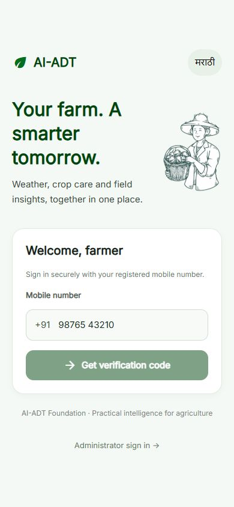
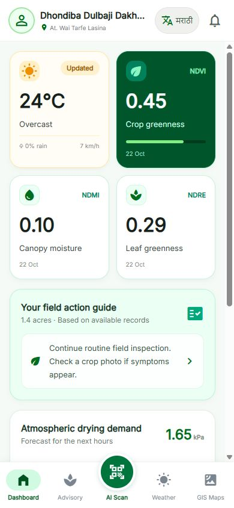
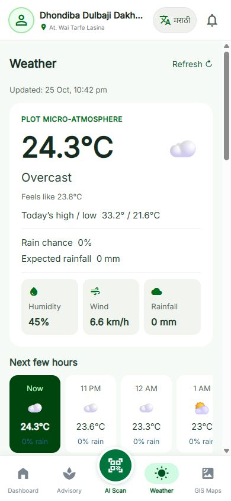
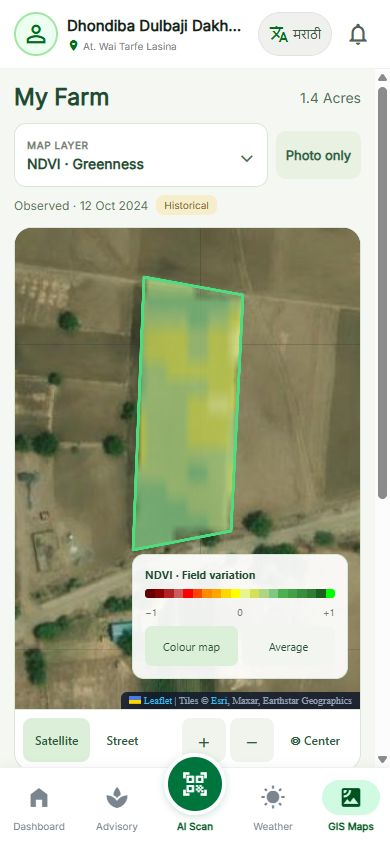
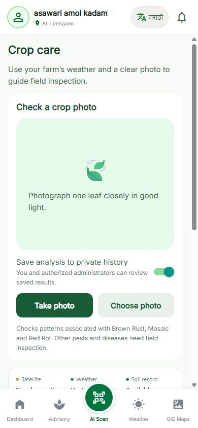
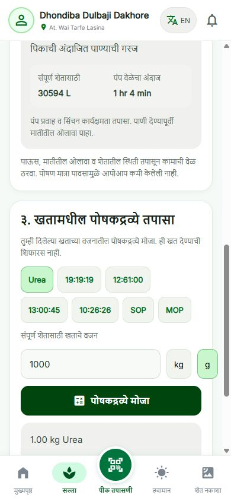
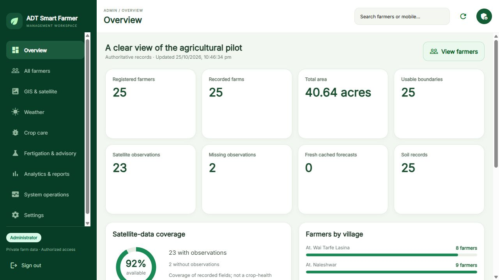

# ADT Smart Farmer V2 — Precision Agriculture Platform

An end-to-end agricultural intelligence platform integrating **Sentinel-2 & SAR satellite remote sensing (7 GIS maps including VRA)**, **FAO-56 microclimate analytics**, **Dual-Model AI Sugarcane Pest & Disease Detection (UNet + EfficientNet-B0)**, **FertiNex DAP-based STCR fertigation scheduling**, and an **Admin Management Workspace** — with full **English & Marathi (मराठी)** bilingual support.

---

## Demo / Test Farmer Account (Try the App)

Anyone testing the Web App or Android APK can log in immediately using the dedicated demo farmer profile stored in Supabase Cloud (complete with a real 5-acre KML farm boundary in Beed, Maharashtra, 14 soil lab parameters, live Sentinel-2/VRA satellite maps, and an active FertiNex fertigation schedule):

| Field | Value |
| :--- | :--- |
| **Farmer Name** | **Ajay Shinde** |
| **Mobile Number** | **`9876543210`** |
| **Verification OTP** | **`123456`** |
| **PRN** | `2836` |
| **Location** | Beed, Maharashtra (`19.1038° N, 76.3122° E`) |
| **Farm Area & Crop** | `5.0 Acres` (`2.0234 ha`) — Sugarcane (`Co 86032`, Adsali) |
| **Recorded Soil Profile** | `pH: 7.65` · `EC: 0.38` · `OC: 0.62%` · `N: 145` · `P: 18.4` · `K: 325` · `Na: 1.12` · `CaCO₃: 4.25` · `Fe: 4.85` · `Mg: 1.62` · `Zn: 0.74` · `Cu: 0.88` · `S: 14.5` · `B: 0.68` |

---

## Download Android App (APK)

Download the latest signed Android APK directly from the **GitHub Releases** page:

> **[Download Latest Android APK (Releases)](https://github.com/ajayshinde38/ADT-Smart-Farmer-V2/releases/latest)**

### Installing on Android
1. Download `ADT-Smart-Farmer-V2-*.apk` from the **Releases** link above.
2. Open the downloaded file on your Android phone and allow **Install from unknown sources** if prompted.
3. Launch **ADT Smart Farmer** and sign in with the demo farmer credentials (`9876543210` / OTP `123456`).

---

## App Screenshots

| Farmer Sign-In | Home Dashboard | Microclimate & Weather |
| :---: | :---: | :---: |
|  |  |  |

| Satellite GIS & VRA Maps | AI Pest & Disease Scanner | Marathi Fertigation Advisory |
| :---: | :---: | :---: |
|  |  |  |

### Desktop Admin Management Workspace


---

## Project Technical Requirements

For complete hardware, software, network, database schema, and dependency specifications, see:
> **[Complete Project Requirements Specification (REQUIREMENTS.md)](REQUIREMENTS.md)**

---

## Local Development & Network Access (Wi-Fi / LAN)

When running on your local network, both services bind to `0.0.0.0` to allow access from any phone, tablet, or PC connected to the same Wi-Fi / Ethernet:

- **Web App (Direct FastAPI SPA)**: `http://<YOUR_LAN_IP>:8002/`
- **Swagger Interactive API Documentation**: `http://<YOUR_LAN_IP>:8002/docs`
- **Expo Metro Bundler (Development)**: `http://<YOUR_LAN_IP>:8081/`

---

## Architecture Overview

```
                               ┌──────────────────────────────────────────────┐
                               │           Client Applications                │
                               ├──────────────────────┬───────────────────────┤
                               │  Farmer Mobile App   │ Web App & Admin Panel │
                               │  (Expo / React Native│ (Built Expo Web SPA   │
                               │   Android APK)       │  served by FastAPI)   │
                               └──────────┬───────────┴───────────┬───────────┘
                                          │                       │
                                          ▼                       ▼
                               ┌──────────────────────────────────────────────┐
                               │       FastAPI Production REST API            │
                               ├──────────────────────────────────────────────┤
                               │ • Auth: Phone OTP (Farmers) / Supabase Admin │
                               │ • Weather: Open-Meteo + FAO-56 ET0 / VPD/GDD │
                               │ • GIS: 7 Maps (NDVI,EVI,NDRE,MSAVI,NDMI,NDWI │
                               │        + SAR RVI Multimodal VRA Zonation)    │
                               │ • Crop Care: Dual-Model PyTorch Inference    │
                               │   (ResNet34 UNet + EfficientNet-B0)          │
                               │ • Advisory: FertiNex STCR + DAP Schedule     │
                               └──────────────┬───────────────────────────────┘
                                              │
                      ┌───────────────────────┼───────────────────────┐
                      ▼                       ▼                       ▼
           ┌──────────────────────┐┌──────────────────────┐┌──────────────────────┐
           │   Supabase Cloud     ││ Sentinel-2 / CDSE    ││ Open-Meteo API       │
           │ (Postgres Registry,  ││ (Multispectral Tiles ││ (Hourly Ag Weather & │
           │  KMLs, Soil, Models) ││  & VRA Raster Engine)││  Microclimate Cache) │
           └──────────────────────┘└──────────────────────┘└──────────────────────┘
```

---

## Core Capabilities

1. **Satellite GIS & VRA Zonation (7 Maps)**:
   - Live Sentinel-2 L2A indices: `NDVI`, `EVI`, `NDRE`, `MSAVI`, `NDMI`, `NDWI`.
   - **7th Layer — Multimodal VRA Map**: Combines Optical + SAR Radar Vegetation Index (`0.35 * NDVI + 0.35 * NDRE + 0.30 * RVI`) into 3 actionable management zones.
2. **Dual-Model AI Pest & Disease Detection**:
   - Runs **ResNet34 UNet** (`best_unet.pth` — lesion segmentation mask & affected area %) and **EfficientNet-B0** (`best_sugarcane_efficientnetb0.pth` — multi-label classification for *Brown Rust*, *Mosaic*, and *Red Rot*) together.
   - Displays **Recommended Immediate Intervention**, **Symptoms / Causes / Prevention**, **AI Detection Confidence Bars**, **Chemical References & Dosage Table (FRAC/IRAC/ICAR)**, and **5 Expandable Management Practice Accordions** (*Cultural, Mechanical, Biological, Chemical, Spray Timing*) in English & Marathi.
3. **FertiNex Precision Fertigation Advisory**:
   - Calculates **Days After Plantation (DAP)** and bounded **ICAR/MPKV Rahuri STCR** nutrient targets (`N, P, K`) directly from recorded soil lab chemistry and farm acreage.
   - Tracks applied vs. upcoming drip fertigation schedules from `Fertigation.xlsx`.
4. **Agrometeorology & Microclimate**:
   - Real-time temperature, humidity, wind, rainfall, FAO-56 $\text{ET}_0$, diurnal $\text{VPD}$ (kPa), and cumulative $\text{GDD}$ charts.
5. **Bilingual & Admin Operations**:
   - Instant English / Marathi (`मराठी`) switcher and a role-gated Admin Dashboard for monitoring all registered farmers.

---

## Full-Time 24/7 Cloud Hosting & Production APK Guide

This repository includes a production multi-stage **`Dockerfile`**, **`render.yaml`**, and **`backend/scripts/start_cloud.py`** (which automatically downloads the AI model weights from your private Supabase Storage `models` bucket on startup).

### Step 1: Deploy Backend + Web App 24/7 (Railway or Render)

#### Option A: Deploy on Railway (Recommended for PyTorch — fast, no cold sleep)
1. Push this repo to GitHub and go to [railway.app](https://railway.app) → **New Project** → **Deploy from GitHub Repo** → select `ADT-Smart-Farmer-V2`.
2. Railway automatically detects the root **`Dockerfile`** (which builds both the Expo Web frontend and FastAPI backend into one container).
3. In Railway **Variables**, add your environment secrets from `backend/.env`:
   - `SUPABASE_URL`, `SUPABASE_SECRET_KEY`, `SUPABASE_KEY`
   - `JWT_SECRET` (random 64-char secret)
   - `OPEN_METEO_API_KEY`, `CDSE_CLIENT_ID`, `CDSE_CLIENT_SECRET`
   - `ENVIRONMENT=production`, `DEBUG=false`
4. Under **Settings → Networking**, click **Generate Domain** (e.g., `https://adt-smart-farmer-v2.up.railway.app`).
5. Verify `https://<your-domain>/api/v1/health` returns `{"status": "healthy"}` and `https://<your-domain>/` opens the live Web App!

#### Option B: Deploy on Render.com (Blueprint)
1. Go to [render.com](https://render.com) → **New** → **Blueprint** → select this GitHub repo (`render.yaml` is pre-configured).
2. Fill in the prompted environment variables (`SUPABASE_URL`, `SUPABASE_SECRET_KEY`, `CDSE_CLIENT_ID`, `CDSE_CLIENT_SECRET`, etc.).
3. Choose the **Starter** (or higher — 2 GB RAM recommended for PyTorch dual-model inference) plan so the server runs 24/7 with no spin-down.

### Step 2: Build the Production APK Connected to Your Hosted Server
Once your backend has a permanent HTTPS URL (e.g., `https://adt-smart-farmer-v2.up.railway.app`), build the standalone APK so it works from any phone anywhere on 4G/5G/Wi-Fi:

```powershell
powershell -ExecutionPolicy Bypass -File frontend\scripts\build-final.ps1 -ApiBaseUrl "https://YOUR-LIVE-DOMAIN/api/v1"
```

This creates a signed release APK at:
`artifacts\releases\ADT-Smart-Farmer-V2-2.2.0.apk`

### Step 3: Host the APK on GitHub Releases for Public Download
GitHub does not allow committing files larger than 100 MB directly in git, and recommends **GitHub Releases** for distributing Android APKs (supports up to 2 GB per file for free):
1. Open your GitHub repository → click **Releases** (right sidebar) → **Draft a new release**.
2. Set Tag version to **`v2.2.0`** and Release Title to **`ADT Smart Farmer V2 (v2.2.0 Android APK)`**.
3. Drag and drop `artifacts\releases\ADT-Smart-Farmer-V2-2.2.0.apk` into the **Attach binaries** box.
4. Click **Publish release**.
5. The **Download Latest Android APK** link at the top of this README will automatically serve that APK!

---

## Local Development Setup (Windows / Linux)

### Quick One-Click Launch (Windows)
Double-click **`start-all.bat`** in the project root to launch both FastAPI (`:8002`) and Expo Metro (`:8081`).

### Manual Terminal Startup

#### 1. Backend (FastAPI on Port 8002)
```powershell
python -m pip install -r backend/requirements.txt
# Ensure backend/.env and the two .pth model files in backend/app/modules/pest_disease/models/ are present
python -m uvicorn app.main:app --app-dir backend --host 0.0.0.0 --port 8002 --reload
```
- **Web App (Built)**: `http://localhost:8002/`
- **Swagger API Docs**: `http://localhost:8002/docs`

#### 2. Frontend (Expo Metro on Port 8081)
```powershell
cd frontend
npm install
npx expo start
```

---

## Verification & Testing

```powershell
# Backend test suite (86 tests)
python -m pytest backend/tests -o pythonpath=backend

# Frontend TypeScript check
cd frontend && npm run typecheck

# Rebuild static web bundle served by FastAPI
cd frontend && npm run build:web
```
